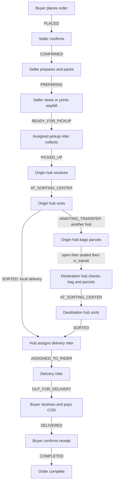

# Shopleap ERP order flow

Reviewed from the current source on 13 November 2026. This describes the web application and rider API. It does not confirm that all migrations are deployed or that the separate mobile app has been released.

The bag has its own status. Orders stay `AWAITING_TRANSFER` during transfer. Local deliveries skip the bag and destination-hub steps.

## 1. Overview

- **Buyer:** chooses items, supplies an address, pays on delivery, and confirms receipt.
- **Seller:** confirms, packs, prepares the label, and requests pickup.
- **Logistics hub:** manages its service areas, riders, sorting, transfers, and delivery problems.
- **Rider:** collects assigned pickups and delivers assigned parcels through the rider API.
- **Admin:** manages approvals and shipping rates, checks transactions, and handles disputes and refunds.
- Each shop gets a separate order. The origin and destination hubs must belong to the same logistics company.
- The buyer confirms a delivered order to reach `COMPLETED`. Some automatic actions are written but unavailable; see section 13.

## 2. Buyer places the order

### 2.1 Choose items and an address

- **Who:** Buyer.
- **Where:** Cart ? `buyer.cart.index`; Checkout ? `buyer.checkout.index`; saved addresses ? `buyer.addresses.index`.
- **What happens:** The buyer selects cart items and a saved delivery address.\
  Checkout groups the items by shop.\
  It checks whether one logistics company serves both the seller's pickup address and the buyer's delivery area.
- **Status after:** No order exists yet.
- **Rules:** The address must belong to this buyer. Products and variants must be available and have enough stock. Missing or unclear hub coverage blocks that shop's checkout.

### 2.2 Review vouchers, shipping, and payment

- **Who:** Buyer.
- **Where:** Checkout ? `buyer.checkout.index`; My Vouchers ? `buyer.vouchers.index`.
- **What happens:** The buyer may choose one eligible shop voucher per shop.\
  Each shop has its own shipping fee.\
  The fee comes from the admin's active zone rate.\
  Payment is cash on delivery, or COD.
- **Status after:** No order exists yet.
- **Rules:** Vouchers must be claimed, valid, unused, and suitable for that shop and its items. They reduce item charges, not shipping. Shipping zones are same municipality, same province, and different province. Weight is displayed but does not set the fee. Missing active rates fall back to PHP 40, PHP 70, and PHP 120 for those zones.

### 2.3 Place the orders

- **Who:** Buyer, followed by the system.
- **Where:** Place Order ? `buyer.checkout.store`; then Purchases ? `buyer.orders.index`.
- **What happens:** The server checks prices, stock, coverage, and vouchers again.\
  It creates one order per shop and deducts stock.\
  It saves the purchased items, prices, delivery address, shipping charge, and voucher amounts.\
  After the orders save successfully, the seller receives an in-app new-order notification.
- **Status after:** `PLACED` for every shop order.
- **Rules:** A validation failure prevents the selected checkout batch from being placed. Only purchased cart items are removed. Later address edits do not replace the order's saved delivery address. Activity notifications are in-app records, not mobile push.

Sources: [Checkout](../app/Http/Controllers/Buyer/CheckoutController.php), [shipping](../app/Services/ShippingFeeCalculator.php), [rates](../app/Models/ShippingRate.php), [vouchers](../app/Services/ShopVoucherService.php), [coverage](../app/Services/HubCoverage.php), [checkout page](../resources/views/Buyer/checkout/index.blade.php), [address storage](../database/migrations/2026_11_04_191245_add_address_snapshot_to_orders_table.php), and [checkout totals](../database/migrations/2026_11_11_231744_add_checkout_snapshots_to_orders_table.php).

## 3. Seller prepares the order

### 3.1 Confirm and prepare

- **Who:** The seller who owns the order.
- **Where:** Orders and Prepare & Ship Orders ? `seller.orders.index`; order page ? `seller.orders.show`; status action ? `seller.orders.status`.
- **What happens:** The seller confirms the new order.\
  The seller then moves it into preparation and packs the items.\
  These are separate actions.\
  The buyer receives progress notifications.
- **Status after:** First `CONFIRMED`, then `PREPARING`.
- **Rules:** The seller cannot skip these forward steps or mark an order delivered through this action. Another seller cannot manage the order.

### 3.2 View and print the waybill

- **Who:** The seller who owns the order.
- **Where:** View Waybill ? `seller.orders.waybill.view`; PDF and Print/Reprint Waybill ? `seller.orders.waybill`.
- **What happens:** The preview uses the same 4-by-6-inch PDF used for printing.\
  The label shows the order reference, buyer and seller details, items, charges, barcode, and QR code.\
  New orders receive random public order numbers and random waybill codes.\
  New barcodes and QR codes encode the stored waybill code.
- **Status after:** The status stays unchanged.
- **Rules:** Both routes check seller ownership. Codes use secure randomness, avoid look-alike characters, have unique indexes, and retry collisions. Public order URLs use the public order number. Already-printed older labels keep their original printed number, barcode, and QR on reprints. Opening the PDF records it as printed; it does not prove paper was printed.

### 3.3 Request pickup

- **Who:** Seller.
- **Where:** Order page ? `seller.orders.show`; Request Pickup ? `seller.orders.request-pickup`.
- **What happens:** The seller requests collection from the assigned origin hub.\
  They choose a pickup date and a morning or afternoon slot.\
  The system saves the request and destination hub.\
  The buyer and hub receive relevant progress notifications.
- **Status after:** `READY_FOR_PICKUP`; pickup stage `requested`.
- **Rules:** The order must be `PREPARING`, with a recorded waybill print. The date must be from today through seven days ahead. A pending buyer cancellation request must be answered first. The seller cannot choose an arbitrary pickup hub.

### 3.4 Cancel or rearrange before collection

- **Who:** Buyer, seller, or origin hub, depending on the action.
- **Where:** `buyer.orders.cancel`, `buyer.orders.cancel-request.withdraw`, `seller.orders.cancel`, `seller.orders.cancel-request.approve`, `seller.orders.cancel-request.decline`, `seller.orders.cancel-pickup`, and `logistics.pickups.decline`.
- **What happens:** A buyer can cancel `PLACED` immediately.\
  In `CONFIRMED`, `PREPARING`, or `READY_FOR_PICKUP`, the buyer asks the seller to cancel.\
  The seller approves or declines.\
  Successful cancellation restores stock and releases the voucher claim.
- **Status after:** `CANCELLED` for a successful cancellation. A pickup withdrawal or hub decline returns the order to `PREPARING`, without cancelling it.
- **Rules:** Sellers can cancel their own orders in `PLACED`, `CONFIRMED`, `PREPARING`, and `READY_FOR_PICKUP`. Normal cancellation stops after collection. A pending buyer request can be withdrawn. A withdrawn request can be sent again; a declined one cannot. Pickup withdrawal and hub decline require no assigned pickup rider. The page promises automatic approval after 24 hours, but this automation is not registered; see section 13.

Sources: [Seller order actions](../app/Http/Controllers/Seller/OrderController.php), [waybill](../app/Http/Controllers/Seller/WaybillController.php), [order rules](../app/Models/Order.php), [random codes](../app/Support/OrderCodes.php), [printed-label compatibility](../database/migrations/2026_11_12_233427_backfill_public_order_identifiers.php), and [cancellation](../app/Services/OrderCancellation.php).

## 4. Rider pickup from the seller

### 4.1 The hub assigns pickup work

- **Who:** Origin hub.
- **Where:** Pickup Requests ? `logistics.pickups.index`; assignment ? `logistics.pickups.assign`.
- **What happens:** The hub sees the seller's request.\
  It assigns an active, approved rider and confirms the schedule.\
  The rider must cover the seller's address.\
  The assigned rider is notified.
- **Status after:** The order stays `READY_FOR_PICKUP`; pickup stage `assigned`.
- **Rules:** Only the origin hub can assign this work. The rider must belong to that hub. An unchanged assignment can keep its earlier acceptance; changing rider or schedule requires fresh acceptance. There is no rider API for browsing all unassigned requests.

### 4.2 The rider accepts or declines

- **Who:** Assigned pickup rider.
- **Where:** Rider API routes `GET /api/courier/pickups`, `POST /api/courier/pickups/{order}/accept`, and `POST /api/courier/pickups/{order}/decline`. These routes have no Laravel route names.
- **What happens:** The API lists this rider's waiting pickups in their own hub.\
  It includes the shop, pickup address, schedule, item count, weight, and label readiness.\
  The assigned rider receives the seller's trimmed phone number while the order is awaiting pickup.\
  Declining returns the pickup to the hub for reassignment.
- **Status after:** The order stays `READY_FOR_PICKUP`. Accept sets pickup `accepted`. Decline removes the rider and returns pickup to `requested`.
- **Rules:** Working endpoints require an active courier account, an approved active rider profile, and an available hub. Accept requires seller-area coverage. Decline requires a reason and is allowed only before acceptance. Order action URLs use the public order number.

### 4.3 Collect and bring the parcel to the hub

- **Who:** Assigned pickup rider.
- **Where:** Rider API route `POST /api/courier/pickups/{order}/confirm`; hub web stand-in ? `logistics.pickups.confirm`.
- **What happens:** The rider submits the scanned waybill code.\
  The server checks that it identifies this order.\
  The rider collects the parcel and physically brings it to the origin hub.\
  The API response tells the rider to bring it there.
- **Status after:** `PICKED_UP`.
- **Rules:** Mobile confirmation requires an accepted pickup, seller-area coverage, and a printed label. A wrong scan or cancelled order is rejected. The seller's phone is null after pickup, including in this confirmation response. Hub arrival is a separate action.

Sources: [Hub pickup actions](../app/Http/Controllers/Logistics/PickupController.php), [pickup API](../app/Http/Controllers/Api/Courier/PickupController.php), [courier access](../app/Http/Middleware/EnsureCourier.php), [rider coverage](../app/Services/RiderCoverage.php), and [scan resolution](../app/Support/ScanCode.php).

## 5. Origin hub

### 5.1 Receive the collected parcel

- **Who:** Origin hub.
- **Where:** Incoming Parcels ? `logistics.incoming.index`; Confirm Arrival ? `logistics.incoming.confirm-arrival`.
- **What happens:** Staff find the collected parcel in Incoming Parcels.\
  They confirm its arrival.\
  The system records the holding hub and a tracking event.
- **Status after:** `AT_SORTING_CENTER`.
- **Rules:** The order must be `PICKED_UP` and belong to this holding hub. This page uses a confirmation action; transfer bag scanning is a separate inbound process.

### 5.2 Start a sorting session and scan

- **Who:** Hub staff.
- **Where:** Sort and Assign ? `logistics.sorting.index`; `logistics.sorting.sessions.start`; `logistics.sorting.sessions.scan`. Manual sort actions are `logistics.sorting.sort` and `logistics.sorting.sort-all`.
- **What happens:** Staff start a session or resume the hub's active one.\
  They use the camera or enter a code manually.\
  The system checks the holding hub, order status, and destination coverage.\
  It records successful, duplicate, rejected, and needs-review scans.
- **Status after:** `SORTED` for delivery by this hub, or `AWAITING_TRANSFER` for another hub in the same company. Rejected and needs-review scans do not advance the order.
- **Rules:** Scanning requires an active session and a parcel held by this hub in `AT_SORTING_CENTER`. Repeated processed scans are logged instead of sorting the parcel again. Missing destination coverage creates a needs-review scan result, not a new order status.

### 5.3 Assign local parcels and end the session

- **Who:** Hub staff.
- **Where:** `logistics.sorting.assign`; `logistics.sorting.sessions.end`; `logistics.sorting.sessions.summary`; session history ? `logistics.sorting.sessions.index`.
- **What happens:** The page groups parcels by destination hub and buyer barangay.\
  It suggests the barangay rider, falling back to the municipality rider.\
  Staff can assign an individual local parcel.\
  Ending the session records its duration and returns scan totals and destination groups.
- **Status after:** Successful assignment gives `ASSIGNED_TO_RIDER`. Ending the session does not change order statuses.
- **Rules:** The rider must be active, approved, in this hub, and mapped to the buyer's area. Another hub's parcels cannot be assigned for local delivery here. The grouped assignment button has a server-validation mismatch; it is not documented as working. The session summary is not a permanent assignment ledger. See section 13.

Sources: [Incoming](../app/Http/Controllers/Logistics/IncomingParcelController.php), [sorting](../app/Http/Controllers/Logistics/SortingController.php), [sessions](../app/Http/Controllers/Logistics/SortingSessionController.php), [session counts](../app/Models/SortingSession.php), [sorting page](../resources/views/logistics/sorting/index.blade.php), and [camera/manual scanning](../resources/js/pages/logistics/scanner.js).

## 6. Outbound transfer between hubs

### 6.1 Create a bag and select parcels

- **Who:** Sending hub.
- **Where:** Outbound Transfer ? `logistics.outbound.index`; `logistics.outbound.bags.store`; `logistics.outbound.show`; add/remove ? `logistics.outbound.orders.store` and `logistics.outbound.orders.destroy`.
- **What happens:** Staff choose another hub in the same company.\
  They create a bag and select parcels for that destination.\
  The saved bag membership becomes the manifest parcel list.
- **Status after:** Bag `open`; orders remain `AWAITING_TRANSFER`.
- **Rules:** Parcels must be held by this hub, match the destination hub and province, and not already be in another active bag. Only an open bag can be edited.

### 6.2 Seal and print the manifest

- **Who:** Sending hub.
- **Where:** `logistics.outbound.seal`; `logistics.outbound.manifest`; `logistics.outbound.manifest.printed`.
- **What happens:** Staff seal a non-empty bag.\
  They open the print-friendly manifest with the bag code and parcel waybill codes.\
  The Print button records the attempt and opens the browser print dialog.\
  The system checks that the printed parcel list still matches the saved bag.
- **Status after:** Bag `sealed`; orders remain `AWAITING_TRANSFER`.
- **Rules:** An open bag cannot print a manifest. Sealing clears an earlier print record. A recorded manifest print is required before dispatch; it does not prove physical printing.

### 6.3 Dispatch the bag

- **Who:** Sending hub.
- **Where:** Outbound bag ? `logistics.outbound.dispatch`.
- **What happens:** Staff mark the bag as in transit.\
  The system records dispatch time and parcel events.\
  The receiving hub is notified.
- **Status after:** Bag `in_transit`; orders remain `AWAITING_TRANSFER`.
- **Rules:** Only the sending hub can dispatch. The bag must be sealed and have a recorded manifest print.

Sources: [Outbound actions](../app/Http/Controllers/Logistics/OutboundController.php), [bag states](../app/Models/ShipmentBag.php), [bag membership](../database/migrations/2026_10_31_020000_create_shipment_bag_items_table.php), [manifest page](../resources/views/logistics/outbound/manifest.blade.php), and [printing](../resources/js/pages/logistics/outbound-manifest.js).

## 7. Destination hub

### 7.1 Check the bag and its manifest

- **Who:** Receiving hub.
- **Where:** Inbound ? `logistics.inbound.index`; bag page ? `logistics.inbound.show`; `logistics.inbound.verify`; index scan ? `logistics.inbound.scan.index`.
- **What happens:** Staff scan or enter the bag code.\
  It must match the selected bag and be addressed to this hub.\
  Verification unlocks parcel checking in that browser session.\
  The parcel list comes from saved manifest membership.
- **Status after:** Scanning the bag alone does not complete receipt or change order statuses.
- **Rules:** The normal path receives a dispatched bag. The current server also accepts sealed bags before dispatch; see section 13. The index scanner can identify a parcel and find its incoming bag.

### 7.2 Receive parcels and close the bag

- **Who:** Receiving hub.
- **Where:** `logistics.inbound.scan`, `logistics.inbound.parcels.confirm`, and `logistics.inbound.close`.
- **What happens:** Staff scan each waybill or use its confirmation action.\
  A parcel must belong to the saved bag list.\
  Receipt records the parcel as received and puts a waiting transfer into this hub's sorting queue.\
  Closing the bag checks for unreceived parcels.
- **Status after:** Received orders normally move from `AWAITING_TRANSFER` to `AT_SORTING_CENTER`. The bag becomes `received` if all parcels are confirmed, or `discrepancy` if any are missing.
- **Rules:** Repeat receipt does not receive a parcel twice. Missing parcels get events and both hubs are notified on the first discrepancy close. Missing orders are not automatically cancelled or received. Late parcels can be confirmed and the discrepancy bag closed again. Parcels that arrived can proceed to sorting while others remain missing.

### 7.3 Sort and assign at the destination

- **Who:** Destination hub.
- **Where:** Sort and Assign ? `logistics.sorting.index`, `logistics.sorting.sessions.start`, `logistics.sorting.sessions.scan`, and `logistics.sorting.assign`.
- **What happens:** Staff use the same sorting session process as the origin hub.\
  The system checks the buyer's saved delivery area.\
  Staff assign a local parcel to the barangay's rider or the municipality fallback.
- **Status after:** First `SORTED`, then `ASSIGNED_TO_RIDER`. Changed routing can instead give `AWAITING_TRANSFER` to another hub in the same company.
- **Rules:** Only the current holding hub may sort or assign. The rider must be approved, active, in the hub, and cover the address. The grouped-assignment limitation in section 5 applies here too.

Sources: [Inbound actions](../app/Http/Controllers/Logistics/InboundController.php), [inbound page](../resources/views/logistics/inbound/show.blade.php), [sorting](../app/Http/Controllers/Logistics/SortingController.php), and [coverage](../app/Services/HubCoverage.php).

## 8. Rider delivery

### 8.1 Check assignments and go out

- **Who:** Assigned delivery rider.
- **Where:** API routes `GET /api/courier/deliveries` and `POST /api/courier/deliveries/{order}/out`.
- **What happens:** The API lists assigned and out-for-delivery parcels.\
  It includes the buyer's name, phone, address, note, COD amount, item count, weight, and attempt information.\
  The rider marks an assigned parcel as out for delivery.
- **Status after:** `OUT_FOR_DELIVERY`.
- **Rules:** The rider must own the assignment, belong to the holding hub, and cover the buyer's address. Delivery endpoints do not supply the seller's pickup phone. These are API capabilities; the separate mobile app's released screen design is not established by this repository.

### 8.2 Collect COD and record delivery

- **Who:** Delivery rider; the buyer physically receives and pays.
- **Where:** API route `POST /api/courier/deliveries/{order}/delivered`.
- **What happens:** The rider submits the cash collected.\
  The system saves delivery time and COD collection.\
  It keeps a fixed record of the delivering hub, delivery rider, shipping fee, and current rider rate for the parcel.\
  The buyer is notified to confirm receipt.
- **Status after:** `DELIVERED`.
- **Rules:** The order must be `OUT_FOR_DELIVERY` with an assigned rider. The amount must be non-negative. A different amount from the expected COD adds a discrepancy note instead of blocking delivery. Repeating successful delivery does not earn a second payment. There is no cash-remittance confirmation step.

### 8.3 Handle failed delivery

- **Who:** Rider, then holding hub.
- **Where:** API route `POST /api/courier/deliveries/{order}/failed`; Delivery Management ? `logistics.deliveries.index`, `logistics.deliveries.reschedule`, and `logistics.deliveries.return`.
- **What happens:** The rider chooses an allowed failure reason and may add a short note.\
  The system adds one failed attempt.\
  The hub decides whether to reschedule or return the parcel.\
  Returning after failed delivery restores stock.
- **Status after:** Failure gives `DELIVERY_FAILED`. Rescheduling gives `ASSIGNED_TO_RIDER`. Return gives `RETURNED`.
- **Rules:** Failure starts only from `OUT_FOR_DELIVERY`. After three failed attempts, the hub cannot reschedule. It may choose return earlier. Return is a recorded decision, not a complete reverse-delivery journey.

### 8.4 Check dashboard, history, and earnings

- **Who:** Rider.
- **Where:** API routes `GET /api/courier/dashboard`, `GET /api/courier/history`, `GET /api/courier/earnings`, `GET /api/courier/earnings/history`, and `GET /api/courier/earnings/rate`.
- **What happens:** The API supplies pickup and delivery counts.\
  It includes a waiting-hub-decision count for failures.\
  History lists delivered, completed, and returned delivery work.\
  Earnings use saved successful-delivery records.
- **Status after:** No change.
- **Rules:** The main delivery list includes `ASSIGNED_TO_RIDER` and `OUT_FOR_DELIVERY`, not a detailed failed-parcel list. This is delivery history, not a full pickup history. Recorded earnings do not prove that COD was remitted or rider wages were paid.

Sources: [Delivery API](../app/Http/Controllers/Api/Courier/DeliveryController.php), [shared transitions](../app/Services/OrderTransitions.php), [hub delivery actions](../app/Http/Controllers/Logistics/DeliveryController.php), [dashboard](../app/Http/Controllers/Api/Courier/DashboardController.php), [history](../app/Http/Controllers/Api/Courier/HistoryController.php), and [earnings API](../app/Http/Controllers/Api/Courier/EarningsController.php).

## 9. Buyer confirmation

### 9.1 Confirm Order Received

- **Who:** Buyer who owns the order.
- **Where:** Purchases, Completed tab ? `buyer.orders.index`; Confirm Order Received ? `buyer.orders.confirm`.
- **What happens:** A delivered order already appears under the Completed tab.\
  The buyer checks the parcel and confirms receipt.\
  The system records confirmation.\
  The seller's sale then counts as realized income in sales reports.
- **Status after:** `COMPLETED`.
- **Rules:** The confirmation changes only `DELIVERED`. The Completed tab name does not prove the status is already `COMPLETED`. Manual confirmation does not check for an open return request. The written automatic rule waits seven days and skips open return requests, but its handler is not registered in the current application.

### 9.2 Review the items

- **Who:** Buyer.
- **Where:** Purchases review action ? `buyer.orders.review.store`.
- **What happens:** The buyer rates an item from one to five.\
  A comment is optional.\
  Up to five supported photos or videos can be attached.\
  The seller can view and reply to reviews.
- **Status after:** The order stays `COMPLETED`.
- **Rules:** The order must be `COMPLETED`. The item must belong to this buyer's order. Each purchased order item gets one review. Each uploaded file is limited to 20 MB.

### 9.3 Request a return or refund

- **Who:** Buyer, seller, and admin at different stages.
- **Where:** `buyer.orders.return.create`, `buyer.orders.return.store`, `buyer.returns.show`, `seller.returns.approve`, `seller.returns.decline`, `seller.returns.received`, `seller.returns.problem`, `admin.returns.decide`, and `admin.returns.refunded`.
- **What happens:** The buyer selects purchased items, a supported reason, and refund account details.\
  A normal request goes to the seller; a non-receipt claim goes directly to admin review.\
  An approved physical return is shipped back with an outside courier and tracking number.\
  Admin sends money outside the app, then records the refund reference.
- **Status after:** A separate physical-return request normally follows `requested`, `approved`, `shipped_back`, `refund_pending`, and `refunded`. Refund-only approval skips shipping. Non-receipt begins at `disputed`. The order itself stays `DELIVERED` or `COMPLETED`.
- **Rules:** The default request window is seven days from delivery, not from buyer confirmation. Admin can set one to thirty days. Requests are allowed in `DELIVERED` or `COMPLETED`, within the window, with no earlier blocking request. Most reasons need evidence. Change of mind is not supported. Selected order lines use their full purchased quantities, not a smaller quantity within one line.

### 9.4 Follow a declined or disputed request

- **Who:** Buyer, seller, and admin.
- **Where:** `buyer.returns.withdraw`, `buyer.returns.ship`, `buyer.returns.escalate`, `seller.returns.problem`, and `admin.returns.decide`.
- **What happens:** A seller can decline with a reason.\
  The buyer has three days to ask admin to review the decline.\
  After physical-return approval, the buyer has seven days to ship back.\
  The seller can confirm receipt or report a problem, and admin resolves disputes.
- **Status after:** Other request states include `declined`, `disputed`, `rejected`, `cancelled`, and `expired`. They are not order statuses.
- **Rules:** The written deadline logic gives the seller three days to answer, and three days to confirm a returned shipment. It contains automatic approval, closure, expiry, and receipt rules. These automatic actions are unavailable because their command is not registered. Opening a request does not transfer money or undo delivery. See section 13.

Sources: [Buyer confirmation](../app/Http/Controllers/Buyer/OrderController.php), [Purchases page](../resources/views/Buyer/orders/_content.blade.php), [reviews](../app/Http/Controllers/Buyer/ReviewController.php), [return eligibility](../app/Models/Order.php), [return states](../app/Models/OrderReturn.php), [return actions](../app/Services/OrderReturns.php), [buyer return form](../app/Http/Controllers/Buyer/ReturnController.php), and [admin refunds](../app/Http/Controllers/Admin/ReturnController.php).

## 10. Money flow

### Item charges, vouchers, and commission

The buyer owes the shop's item subtotal, minus its shop voucher, plus that shop's shipping fee. A voucher cannot reduce the item charge below zero. Shipping is charged separately.

The actual commission is **10% of the item amount after the shop voucher discount**. It is not 10% of shipping or 10% of the original undiscounted subtotal.

For example, PHP 1,000 of items with a PHP 100 voucher leaves PHP 900 in item charges. Commission is PHP 90. The seller's share is PHP 810 before later refunds. With PHP 70 shipping, the buyer pays PHP 970 COD.

### When amounts count

| Party | Amount recorded or counted | When it counts | Limit |
| --- | --- | --- | --- |
| Seller | Discounted item charges less commission, adjusted for counted refunds | `COMPLETED` | Pending orders are separate. This is not a bank payout. |
| Admin/platform | 10% commission, less counted reversals | `COMPLETED` | No automatic commission settlement. |
| Delivering hub | Shipping fee saved at successful delivery | `DELIVERED` and `COMPLETED` | Credited to the delivering hub. No implemented origin or transfer-fee split. |
| Delivery rider | Delivering hub's rate per successfully delivered parcel | Saved at `DELIVERED` | No separate pickup fee or wage-payment confirmation. |
| Buyer | Cash amount submitted by the rider | Successful delivery | Cash can differ from the expected amount. No remittance ledger. |

The hub sets its rate through Rider Rate ? `logistics.rider-rate.index` and `logistics.rider-rate.store`. A zero rate is allowed. The rate must be lower than the lowest configured shipping fee. Successful delivery saves the rate, rider, and hub for that parcel. Later rate changes do not change saved delivery earnings.

A delivery without a configured rider rate has an unknown saved earning. Some API summaries display zero instead. The code does not fill earlier missing earnings with a later rate.

### Returns, refunds, and reversals

Refunds use selected items' purchase amounts after their allocated voucher discounts. Buyers do not receive the voucher discount as extra cash. Selecting every order line includes the original shipping charge; selecting only some lines does not.

Commission reversals are proportional to the refunded item amount. Seller and admin transaction reports deduct item refunds and commission reversals. They start deducting at `refund_pending`, before the payment is marked `refunded`.

The refund service does not undo the delivery status or reverse saved rider pay. It does not send money through GCash, Maya, or a bank. Admin must send the money separately and record a reference.

Logistics delivery-income reports use saved shipping fees and rider pay. They do not apply the same refund deductions as net order totals elsewhere. Refunded shipping can therefore remain in a logistics delivery-income total.

Cancellation restores stock and releases the voucher claim. Failed-delivery `RETURNED` restores stock. Buyer return/refund processing does not automatically restock returned goods or restore voucher claims.

Sources: [Checkout calculation](../app/Http/Controllers/Buyer/CheckoutController.php), [seller reports](../app/Services/SellerReportService.php), [admin transactions](../app/Services/AdminTransactionService.php), [net amounts](../app/Models/Order.php), [refund calculation](../app/Services/OrderReturns.php), [rate management](../app/Http/Controllers/Logistics/RiderRateController.php), [delivery earning records](../app/Services/OrderTransitions.php), [earning totals](../app/Services/RiderEarnings.php), and [logistics income](../app/Services/LogisticsReportService.php).

## 11. Status reference table

### Order statuses

These are the paths found in the handlers. Normal order routes resolve the public order number. Rider API routes below have no Laravel route names.

| Exact status | Who or what reaches it | Page, route, or API action | Next possible order statuses |
| --- | --- | --- | --- |
| `PLACED` | Buyer checkout | Checkout ? `buyer.checkout.store` | `CONFIRMED`, `CANCELLED` |
| `CONFIRMED` | Seller confirms | `seller.orders.status` | `PREPARING`, `CANCELLED` |
| `PREPARING` | Seller prepares, or pickup is rearranged | `seller.orders.status`, `seller.orders.cancel-pickup`, `logistics.pickups.decline` | `READY_FOR_PICKUP`, `CANCELLED` |
| `READY_FOR_PICKUP` | Seller requests collection | `seller.orders.request-pickup` | `PICKED_UP`, `PREPARING`, `CANCELLED` |
| `PICKED_UP` | Pickup rider or hub stand-in | `POST /api/courier/pickups/{order}/confirm`, `logistics.pickups.confirm` | `AT_SORTING_CENTER` |
| `AT_SORTING_CENTER` | Origin confirms arrival or destination receives a transferred parcel | `logistics.incoming.confirm-arrival`, `logistics.inbound.scan`, `logistics.inbound.scan.index`, `logistics.inbound.parcels.confirm` | `SORTED`, `AWAITING_TRANSFER` |
| `SORTED` | Hub sorts for local delivery | `logistics.sorting.sessions.scan`, `logistics.sorting.sort`, `logistics.sorting.sort-all` | `ASSIGNED_TO_RIDER`; `AWAITING_TRANSFER` if routing sends it elsewhere |
| `AWAITING_TRANSFER` | Hub identifies another delivery hub | Sorting actions above, or routing checked during assignment | `AT_SORTING_CENTER` when the receiving hub confirms the parcel |
| `ASSIGNED_TO_RIDER` | Hub assigns a parcel or reschedules a failed attempt | `logistics.sorting.assign`, `logistics.deliveries.reschedule`; group action has a limitation in section 13 | `OUT_FOR_DELIVERY` |
| `OUT_FOR_DELIVERY` | Assigned rider or hub stand-in | `POST /api/courier/deliveries/{order}/out`, `logistics.deliveries.out` | `DELIVERED`, `DELIVERY_FAILED` |
| `DELIVERED` | Rider records COD and delivery, or hub stand-in | `POST /api/courier/deliveries/{order}/delivered`, `logistics.deliveries.delivered` | `COMPLETED`; returns change a separate request status |
| `COMPLETED` | Buyer confirms receipt | `buyer.orders.confirm`; automatic handler is not registered | No further order status; an eligible return request is separate |
| `DELIVERY_FAILED` | Rider or hub records failure | `POST /api/courier/deliveries/{order}/failed`, `logistics.deliveries.failed` | `ASSIGNED_TO_RIDER`, `RETURNED` |
| `RETURNED` | Hub returns a failed delivery | `logistics.deliveries.return` | None implemented |
| `CANCELLED` | Buyer instantly cancels, seller cancels, or seller approves cancellation | `buyer.orders.cancel`, `seller.orders.cancel`, `seller.orders.cancel-request.approve` | None implemented |

Pickup requests also use `requested`, `assigned`, `accepted`, `declined`, and `cancelled`. These do not replace the order statuses. Rider decline returns the pickup to `requested`; hub decline returns the order to `PREPARING`.

### Bag statuses

| Exact status | Who or what reaches it | Page or route | Next possible bag statuses |
| --- | --- | --- | --- |
| `open` | Sending hub creates a bag | Outbound Transfer ? `logistics.outbound.bags.store` | `sealed` |
| `sealed` | Sending hub seals a non-empty bag | `logistics.outbound.seal` | Normally `in_transit`; current inbound code also allows `received` or `discrepancy` directly |
| `in_transit` | Sending hub dispatches after manifest printing is recorded | `logistics.outbound.dispatch` | `received`, `discrepancy` |
| `received` | Receiving hub closes a fully checked bag | `logistics.inbound.close`; index bag-scan handling can also close it | None implemented |
| `discrepancy` | Receiving hub closes with missing parcels | `logistics.inbound.close`; index bag-scan handling can also close it | `received` after late parcels arrive; otherwise stays `discrepancy` |

Sources: [Order constants](../app/Models/Order.php), [bag constants](../app/Models/ShipmentBag.php), [web routes](../routes/web.php), [API routes](../routes/api.php), [transitions](../app/Services/OrderTransitions.php), [sorting](../app/Http/Controllers/Logistics/SortingController.php), and [inbound](../app/Http/Controllers/Logistics/InboundController.php).

## 12. Who can see and do what

?Own? means the account owns the order or has its assignment. Hub access depends on whether it is the origin, current holder, sender, or receiver.

| Main action | Buyer | Seller | Logistics hub | Rider | Admin |
| --- | --- | --- | --- | --- | --- |
| Place orders | Own cart | No | No | No | No buyer checkout action |
| See order progress | Own orders | Own shop orders | Relevant hub parcels | Assigned work through API | Transaction and return oversight |
| Confirm and prepare | No | Own orders | No | No | No normal preparation action |
| View/print waybill | No seller-label action | Own eligible orders | Parcel codes and manifests | Assigned parcel codes | No separate seller-label action |
| Cancel before pickup | Own order under buyer rules | Own order under seller rules | Can decline an unassigned pickup, not cancel the sale | Can decline an unaccepted assigned pickup | No general order-cancel route |
| Assign pickup rider | No | Requests pickup only | Origin hub | No self-assignment API | No normal hub assignment action |
| Collect from seller | No | Hands over parcel | Web stand-in exists | Assigned pickup rider | No normal pickup action |
| Receive, sort, bag, dispatch | No | No | Relevant hub only | Physically brings parcels | Oversight, not the normal hub workflow |
| Assign delivery rider | No | No | Holding delivery hub | No self-assignment API | No normal hub assignment action |
| Record delivery/failure | No | No | Web stand-in exists | Assigned delivery rider | No normal delivery action |
| Confirm receipt/review | Own eligible order | Can reply to reviews | No | No | No buyer confirmation action |
| Return/refund | Own eligible order | Answers/checks returns | No buyer-return processing action | No return-request action | Resolves disputes and records external refunds |
| Set shipping rates | No | No | No | No | Yes |
| Set rider rate | No | No | Own hub | Reads own hub rate through API | No normal hub-rate form action |
| See earnings | No seller/rider earnings | Own shop reports | Own hub reports | Own delivery earnings | Platform transaction reports |

Role-specific routes still apply even where a policy gives admin broad visibility. A seller cannot view another seller's waybill by changing its public number. Other account roles cannot use the working courier API endpoints.

Sources: [Web access](../routes/web.php), [API access](../routes/api.php), [order policy](../app/Policies/OrderPolicy.php), [courier checks](../app/Http/Middleware/EnsureCourier.php), [hub context](../app/Services/HubContext.php), and [waybill ownership](../app/Http/Controllers/Seller/WaybillController.php).

## 13. Not implemented / differs from the plan

1. **Automatic deadlines are written but not registered.** The current Artisan command list does not include automatic order completion, 24-hour cancellation approval, or return/refund deadlines. The handler files are in a different folder from their namespace and normal command discovery. The application does not register that folder. The schedule and messages promise these actions, but the current app cannot run them as registered commands. This includes automatic approval, closure, expiry, and receipt confirmation. Sources: [completion handler](../app/Commands/AutoCompleteDeliveredOrders.php), [cancellation handler](../app/Commands/AutoApproveCancellationRequests.php), [return deadlines](../app/Commands/ProcessReturnDeadlines.php), [application setup](../bootstrap/app.php), and [schedule](../routes/web.php).

2. **Grouped delivery assignment has a public-reference mismatch.** The sorting page submits public order numbers. The group handler still validates and searches numeric database IDs. The button can fail validation instead of assigning the group. Individual assignment is a separate path and uses public route binding. Sources: [group form](../resources/views/logistics/sorting/index.blade.php) and [group handler](../app/Http/Controllers/Logistics/SortingController.php).

3. **The rider API has no open pickup marketplace or full order-detail endpoint.** A hub must assign pickup work first. The API provides lists and action responses, not all unassigned area requests. This repository does not establish the released mobile screen implementation. Sources: [API routes](../routes/api.php) and [pickups](../app/Http/Controllers/Api/Courier/PickupController.php).

4. **Failed-parcel and pickup history visibility is limited.** The dashboard counts parcels waiting for a hub decision. The delivery list omits `DELIVERY_FAILED`. History lists delivered, completed, and returned delivery work, not a detailed failed-parcel queue or full pickup history. Sources: [dashboard](../app/Http/Controllers/Api/Courier/DashboardController.php), [delivery list](../app/Http/Controllers/Api/Courier/DeliveryController.php), and [history](../app/Http/Controllers/Api/Courier/HistoryController.php).

5. **Money is recorded, not settled automatically.** There is no COD remittance ledger, seller payout workflow, automatic rider wage payment, or payment-provider refund integration in this order flow. Admin records a reference after sending money elsewhere. Sources: [routes](../routes/web.php), [delivery recording](../app/Services/OrderTransitions.php), [earnings](../app/Services/RiderEarnings.php), and [refund recording](../app/Http/Controllers/Admin/ReturnController.php).

6. **Commission differs from a gross-subtotal plan.** It is 10% after the shop voucher discount. Refunds deduct allocated voucher discounts; selected-items-only refunds exclude shipping. Reports start deducting at `refund_pending`, before the refund is marked paid. These are current rules, not proposed corrections. Sources: [checkout](../app/Http/Controllers/Buyer/CheckoutController.php), [refund calculation](../app/Services/OrderReturns.php), and [counted refund states](../app/Models/OrderReturn.php).

7. **Delivery earnings do not fully reverse on buyer refunds.** Saved rider pay is not reversed. Logistics delivery-income totals keep saved shipping fees, while other net reports deduct refunded shipping. There is no separate origin pickup or inter-hub fee split. A missing rider rate is unknown in storage, but some API totals show zero. Sources: [returns](../app/Services/OrderReturns.php), [logistics reports](../app/Services/LogisticsReportService.php), [earnings](../app/Services/RiderEarnings.php), and [earnings API](../app/Http/Controllers/Api/Courier/EarningsController.php).

8. **Print records do not prove physical printing.** Opening the waybill PDF marks it printed. Manifest printing is recorded before the print dialog opens. Cancelling the dialog can still leave the print requirement satisfied. Sources: [waybill generation](../app/Http/Controllers/Seller/WaybillController.php) and [manifest printing](../resources/js/pages/logistics/outbound-manifest.js).

9. **Inbound can skip dispatch.** The normal plan is seal, print, dispatch, then receive. Receiving also accepts `sealed` bags, so a bag can be received without becoming `in_transit`. Source: [inbound rules](../app/Http/Controllers/Logistics/InboundController.php).

10. **Session timing and summary counts have limits.** The stale-session task says inactivity, but measures time since the session started. Recent scans do not reset that test. The assigned-during-session count uses current order status and last update time, not a permanent assignment history. Sources: [stale-session task](../app/Console/Commands/CloseStaleSessionsCommand.php) and [session model](../app/Models/SortingSession.php).

11. **Reverse transport and restocking are partial.** Failed-delivery `RETURNED` restores stock without a complete reverse bag/rider journey. Buyer returns use an outside courier and entered tracking details. Buyer return/refund processing does not automatically restock goods or restore voucher claims. Sources: [failed-delivery return](../app/Http/Controllers/Logistics/DeliveryController.php), [buyer returns](../app/Services/OrderReturns.php), and [voucher restoration](../app/Services/ShopVoucherService.php).

12. **Hub stand-ins remain, and delivery proof is limited.** Hub web actions can record pickup, delivery, and failure. Mobile delivery requires a non-negative amount, but not a recipient OTP, signature, delivery photo, or live location proof. A COD difference only adds a note. Sources: [web stand-ins](../app/Http/Controllers/Logistics/DeliveryController.php), [delivery validation](../app/Http/Controllers/Api/Courier/DeliveryController.php), and [COD handling](../app/Services/OrderTransitions.php).

13. **Order notifications are not mobile push.** Activity notifications use the database channel. The rider API offers notification lists and read actions. No push service is connected to these notifications. Sources: [activity notification](../app/Notifications/ActivityNotification.php) and [notification API](../app/Http/Controllers/Api/Courier/NotificationController.php).

This is a documentation review. No application code, migrations, or configuration were changed. Runtime behavior still depends on deployed migrations, a running scheduler, and the separate mobile application.
